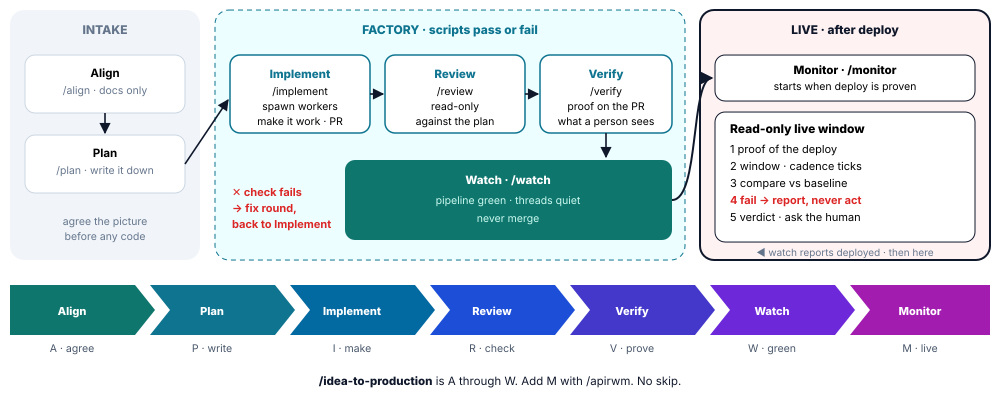

# Public AI

You bring an idea. The line carries it to production.

## Start here

> [!TIP]
> Say **`/idea-to-production`** and the idea.
>
> That name spells the whole range: from the idea to production.

`/idea-to-prod` is the short form of the same range.

| You want | Say |
| --- | --- |
| Nothing on the line yet, and you want it working | `/build` |
| A run that ends with something shipped | `/deliver` |
| This run to move one station forward | `/advance` |

Unsure which skill? **[`/start-here`](skills/start-here/SKILL.md)** 🧭 is the explainer for how to interact with this repo.

## The line

Each station is a skill. A script passes or fails the check. The agent judges only what a script cannot. The seven run in order as one factory.

  

A fail is a fix round back to Implement, not a skip. Review is read-only. Verify puts proof on the pull request. Watch never merges. Monitor is read-only after deploy.

Station manuals and every other name: [skills/CATALOG.md](skills/CATALOG.md).

## On a machine

| Goal | Do |
| --- | --- |
| Rules on your own machine | [AI-setup](AI-setup/README.md) |
| This line in another repo | `skills/setup-repo/scripts/detect-repo.sh <repo>`, then `bootstrap.sh <repo>` |

Operator manual: [AGENTS.md](AGENTS.md). Rules: [rules/](rules/README.md).

## Commands

The stations, one at a time:

- `/align` (A) — agree the picture
- `/plan` (P) — write it down
- `/implement` (I) — make it work
- `/review` (R) — check it against the plan
- `/verify` (V) — prove it on the pull request
- `/watch` (W) — wait for a green pipeline
- `/monitor` (M) — watch the deploy

String the letters to run a range. `/apirvw` is A through W. `/apirwm` adds Monitor.

