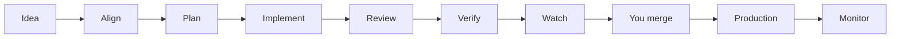

# Public AI

A factory line for an idea. You say what you want. The line carries it from a shared picture, through a merged pull request, to a watch on production.

Generic tech only. [MIT](LICENSE).

## Quick start

Tell the agent:

```text
/apirvw <the idea>
```

That one command runs the whole line up to a green pull request: agree, plan, build, review, prove, watch. You merge. After the change is in production, say `/monitor`.

Want a shorter stop? `/apir` ends once the pull request is proved. Add `/watch` when you are ready for the pipeline, and `/monitor` after deploy.

## The line

Each box is a station. A skill runs the station. A script passes or fails the mechanical checks. The agent judges only what a script cannot.



| Station | You say | What happens |
| --- | --- | --- |
| Align | part of `/apirvw` | You and the agent agree the picture: goal, terms, decisions, and what a person can observe |
| Plan | | That agreement becomes one plan |
| Implement | | Code, unit tests, and a few outside-in tests (the top of the test pyramid) |
| Review | | A read of the diff against the plan. Fixes loop back to implement |
| Verify | | The pull request shows the proof: build, steps, evidence |
| Watch | | The pipeline stays under watch until it is green. The agent does not merge |
| Merge | you | The repo's merge rule decides who clicks merge |
| Monitor | `/monitor` | After deploy, a read-only watch on production |

## How to think about it

Work moves forward on the line. It does not skip a station because the agent feels sure.

- **Agree before building.** Align writes the picture down and waits for your yes.
- **Tests describe what a person sees.** System and API checks are named in the plan, written first from outside the app, and kept few. Unit tests stay with the code.
- **Proof is on the pull request.** A reviewer can rerun it. A story in chat is not the proof.
- **Production is a station.** Merge is not the end. `/monitor` watches the deploy.

The long skills are the station manuals. Short names (`apir`, `pirvw`, `apirvw`) only pick how far down the line to run. The full list is [skills/CATALOG.md](skills/CATALOG.md).

## Put it on a machine

| Goal | Do |
| --- | --- |
| Rules on your own machine | [AI-setup](AI-setup/README.md) |
| This line in another repo | `skills/setup-repo/scripts/detect-repo.sh <repo>`, then `bootstrap.sh <repo>` |

The default links are the daily stations. Aliases and the design skills (`tdd`, `diagnosing-bugs`, `codebase-design`, `start-here`) stay opt-in: `--skills core+aliases`, `--skills all`, or a comma list.

Operator manual: [AGENTS.md](AGENTS.md). Rules: [rules/](rules/README.md).
