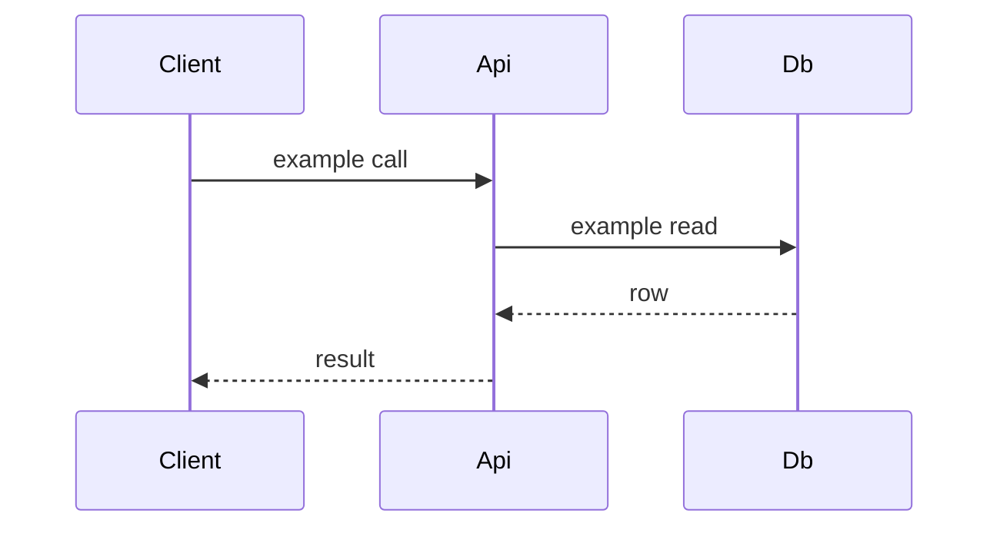

## What changed

One or two sentences. Name the behavior a reviewer can observe.

## Risk

`low`, `medium`, or `high`. One line on why. AI auto-merge: `off` unless `docs/rules/ai-automerge.md` (or the team or org policy) says `on`. Quote that source when it is on.

## Build

- Command: `<the project's check>`
- CI: `<link to this commit's run>`
- Result: `<one green line>`

## Proof

| Claim | Kind | Evidence |
| --- | --- | --- |
| `<what the reviewer can see>` | image, video, curl, log, query, or diagram | `<embedded image, video, or the output snippet>` |

## Try it

1. `<open this preview, or run this one start command>`
2. `<paste this curl, this query, or this script>` — you should see `<the result>`

```bash
# replace with the real call; keep it copy-paste
curl -sS -X POST 'http://localhost:3000/example' \
  -H 'content-type: application/json' \
  -d '{"example":true}'
```

```http
POST /example HTTP/1.1
Host: localhost:3000
Content-Type: application/json

{"example":true}
```

```sql
-- read-only, against the local or preview database named in the step
select id, status from example where id = 'example-id';
```

## Walkthrough

For a deep change, a mermaid diagram of the path. Mark the new hop. Delete this section when the change is a single screen or a single call.


