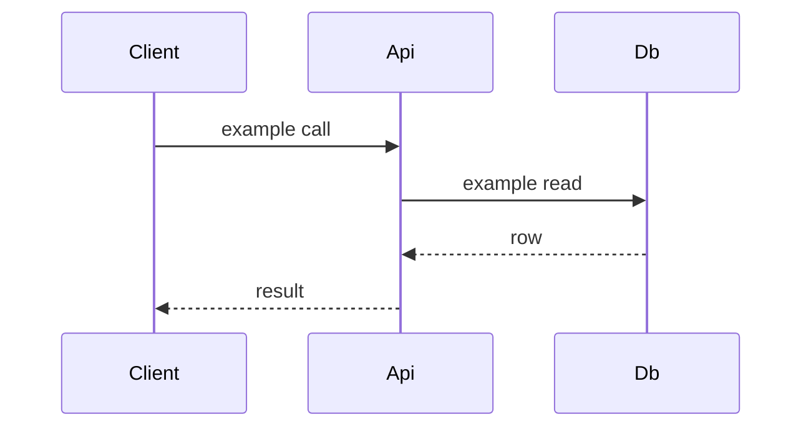

## What changed

One or two sentences. Name the behavior a reviewer can observe. Link the task or issue for the why.

## Risk

`low`, `medium`, or `high`, with one line on why. Then: `Merge policy: <profile>` quoted from its
source (`docs/rules/ai-merge-policy.md` or the org policy), and who must approve under it.

## Review guide

- **Size:** `<n>` changed lines in `<n>` files (generated and lock files excluded). `<n>` commits,
  one logical change each: read them in order
- **Start here:** `<file>`: the one file that explains the change
- **Look hard:** `<file:line>` `<why it is tricky or risky>` (list every hunk that deserves care)
- **Skim:** `<mechanical, generated, renamed or moved files>`
- **Not in this change:** `<what a reviewer might expect but is deliberately left out, and where it
  goes>`
- **Stack:** `<stands alone | depends on !nn | followed by !nn (the riskier one)>`
- **Decisions to check:** `<the one or two judgment calls where you want a second opinion>`

## Build

- Command: `<the project's check>`
- CI: `<link to this commit's run>`
- Result: `<one green line>`

## Proof

| Claim | Kind | Evidence |
| --- | --- | --- |
| `<what the reviewer can see>` | image, video, curl, log, query, or diagram | `<embedded image, video, or the output snippet>` |

## Try it

1. `<open this preview, or run this one start command>`
2. `<paste this curl, this query, or this script>` — you should see `<the result>`

```bash
# replace with the real call; keep it copy-paste
curl -sS -X POST 'http://localhost:3000/example' \
  -H 'content-type: application/json' \
  -d '{"example":true}'
```

```http
POST /example HTTP/1.1
Host: localhost:3000
Content-Type: application/json

{"example":true}
```

```sql
-- read-only, against the local or preview database named in the step
select id, status from example where id = 'example-id';
```

## Rollback

How to undo it: `revert this merge` or, when it is not a clean revert, the exact steps (flag off,
down migration, redeploy the previous build). For a high-tier change this section is required.

## Walkthrough

For a deep change, a mermaid diagram of the path. Mark the new hop. Delete this section when the change is a single screen or a single call.


